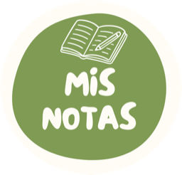
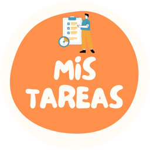
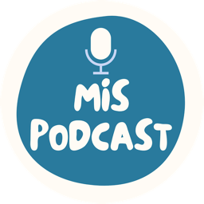
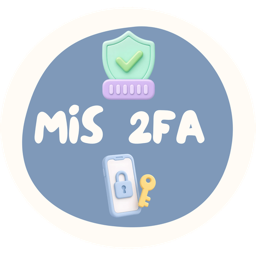

  &nbsp;
  &nbsp;
  &nbsp;
  &nbsp;
  

<h1 align="center">Mis Apps</h1>

  <b>Apps libres para tu día a día, con tus datos en tu propio Nextcloud.</b> 
  Android · Windows · macOS · Linux · Chrome · Firefox

  
  
  
  

---

**Mis Apps** es una familia de aplicaciones de software libre que comparten diseño, filosofía y forma de sincronizar. Cada una resuelve una cosa concreta (notas, tareas, marcadores, podcasts, códigos 2FA) y todas funcionan **sin cuenta y sin conexión**. Si quieres llevarlas a otros dispositivos, se sincronizan con **tu propio servidor Nextcloud**, no con el nuestro.

## 📱 Las apps

<table>
  <tr>
    <td width="72" align="center"></td>
    <td>
      <b><a href="https://github.com/MisApps-labs/mis_notas">Mis Notas</a></b> 
      Notas en Markdown con carpetas, imágenes y listas de tareas. Cifrado de extremo a extremo (AES-256-GCM). 
      Android · <a href="https://github.com/MisApps-labs/mis_notas_desktop">Escritorio</a> · <a href="https://github.com/MisApps-labs/mis_notas_extensiones">Extensión de navegador</a>
    </td>
  </tr>
  <tr>
    <td align="center"></td>
    <td>
      <b><a href="https://github.com/MisApps-labs/mis_tareas">Mis Tareas</a></b> 
      Listas y recados tan sencillos como la lista de la compra. Recordatorios, subtareas, listas compartidas y entrada inteligente. 
      Android · Nextcloud Tasks (CalDAV) o archivos Markdown
    </td>
  </tr>
  <tr>
    <td align="center"></td>
    <td>
      <b><a href="https://github.com/MisApps-labs/mis_marcadores">Mis Marcadores</a></b> 
      Guarda enlaces desde cualquier app con carpetas, etiquetas, «Leer más tarde» y detección de enlaces rotos. 
      Android · <a href="https://github.com/MisApps-labs/mis_marcadores_extensiones">Extensión que sincroniza los marcadores del navegador</a>
    </td>
  </tr>
  <tr>
    <td align="center"></td>
    <td>
      <b><a href="https://github.com/MisApps-labs/MisPodcast">Mis Podcast</a></b> 
      Reproductor de podcasts con Podcasting 2.0, carpetas locales, cola inteligente y Android Auto. 
      Android · Nextcloud (WebDAV / GPodder) · Importa OPML y AntennaPod
    </td>
  </tr>
  <tr>
    <td align="center"></td>
    <td>
      <b><a href="https://github.com/MisApps-labs/mis_2fa">Mis 2FA</a></b> 
      Códigos de verificación en dos pasos (TOTP, HOTP, Steam) cifrados con el Android Keystore. Importa desde Google Authenticator, Aegis, 2FAS… 
      Android · Copia cifrada en Nextcloud
    </td>
  </tr>
</table>

## 🧭 Qué tienen en común

| | |
|---|---|
| 🏠 **Local primero** | Funcionan sin conexión y sin crear ninguna cuenta. La sincronización es opcional. |
| ☁️ **Tu Nextcloud** | Sincronizan con tu servidor mediante WebDAV o CalDAV. Nada pasa por servidores de terceros. |
| 🔐 **Privacidad** | Sin anuncios, sin rastreadores y sin servicios de Google. Cifrado de extremo a extremo donde los datos lo merecen. |
| 🎨 **Una sola familia** | Mismo diseño (tipografías Outfit e Inter, tema claro, oscuro y AMOLED) y los mismos gestos en todas. |
| 🌍 **Cinco idiomas** | Español, inglés, francés, alemán e italiano. |
| 📖 **Software libre** | Licencia GNU GPL v3. El código está aquí, para revisarlo, compilarlo o mejorarlo. |

## 📥 Cómo instalarlas

Cada repositorio tiene sus instaladores en la sección **Releases** (`.apk` para Android; `.msi`, `.dmg`, `.deb` o `.rpm` para escritorio). La extensión de Mis Notas para Firefox está en [addons.mozilla.org](https://addons.mozilla.org/es-ES/firefox/addon/misnotas/).

## 💬 Contacto

¿Una idea o un fallo? Abre un *issue* en el repositorio de la app. Si es un problema de seguridad, no lo publiques: sigue las indicaciones del `SECURITY.md` del repositorio.

Hecho con cuidado por <a href="https://github.com/ferlagod">ferlagod</a>

